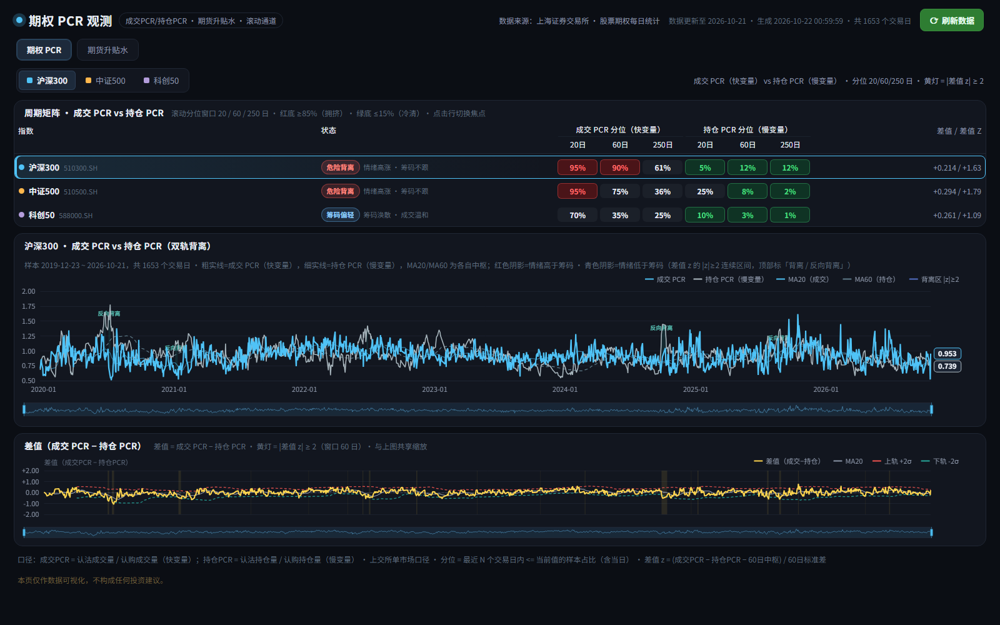
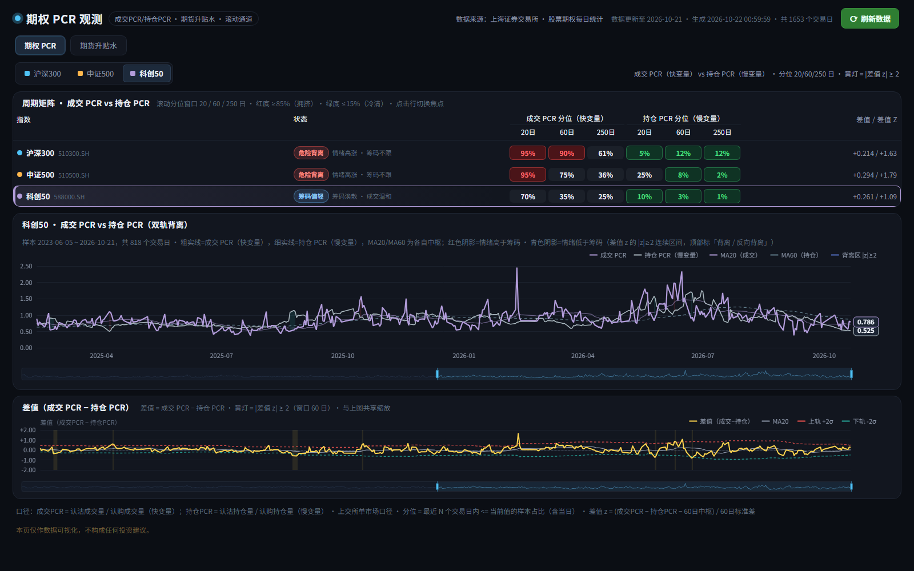
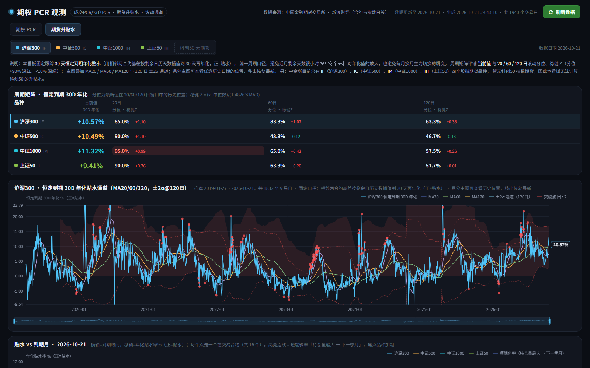
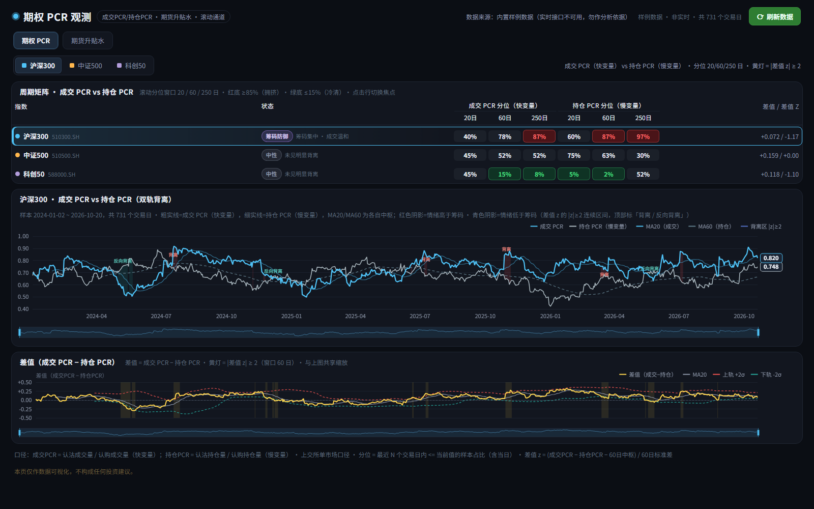

# 期权 PCR 观测 · 期货升贴水看板

> 一个完全本地运行的 A 股期权 / 股指期货观察看板：在浏览器里把 **3 只 ETF 期权的成交 PCR 与持仓 PCR 多周期分位**、以及 **4 个股指期货品种的恒定到期 30 天年化贴水** 放在同一屏里看。数据由本地 Python 服务从上海证券交易所和新浪财经抓取并缓存，没有云服务、没有账号，除 `requests` 外不引入任何第三方 Python 包。



## 功能特性

### 期权 PCR：一屏看「情绪」与「筹码」

- **多周期矩阵**：沪深300（510300）、中证500（510500）、科创50（588000）三个品种 × 20 / 60 / 250 日滚动分位，成交 PCR（快变量）与持仓 PCR（慢变量）左右对照；分位 ≥ 85% 标红（拥挤）、≤ 15% 标绿（冷清），其余中性。
- **9 档状态标签**：危险背离、情绪共振、恐慌未确认、筹码压制、乐观共振、筹码防御、筹码偏轻、情绪偏暖、中性。情绪分位取成交 PCR 的 20 日分位，筹码分位取持仓 PCR 的 250 日分位；样本不足时显示 `—`。
- **双轨主图**：成交 PCR 实线 + 持仓 PCR 细实线叠加，分别带 MA20 / MA60；两者差值 z 的 `|z| ≥ 2` 连续区间在两条线之间填红/青阴影（红 = 情绪高于筹码，青 = 情绪低于筹码）。
- **差值布林**：`差值 = 成交 PCR − 持仓 PCR`，叠加 MA20 与 60 日布林带（MA60 ± 2σ）；最新一天 `|差值 z| ≥ 2` 时标题右侧亮黄灯「情绪极值」。
- **悬停联动**：鼠标悬停主图或差值图时，顶部矩阵的 18 个分位、状态标签、差值/差值 z 全部切换为该日快照，面板标题右侧由「数据日期 YYYY-MM-DD」变为蓝色「悬停 YYYY-MM-DD」；移出图表、切换品种或刷新数据后回到最新日。

### 期货升贴水：恒定到期 30D

- **周期矩阵**：IF（沪深300）、IC（中证500）、IM（中证1000）、IH（上证50）四个品种，行内平铺当前值与 20 / 60 / 120 日滚动分位、稳健 Z（分位 > 90% 深红、< 10% 深绿）。
- **主图**：固定跟踪「恒定到期 30 天」年化贴水，叠加 MA20 / MA60 / MA120 与 120 日 ±2σ 通道；悬停主图时矩阵数值跟随悬停日。
- **期限结构**：把当日各品种在交易合约的近月 → 远月年化贴水连成曲线，并高亮「持仓量最大合约 → 下一季月」的短端斜率。
- **没有科创50 期货**：中金所目前只有 IF / IC / IM / IH 四个股指期货品种，页面用禁用芯片和说明行明确写出这一点，而不是默默少一个品种。

### 通用

- **深链与状态复现**：期权 tab 形如 `#idx=kc50&zoom=0.3,1`，期货 tab 形如 `#tab=fut&fidx=zz1000&zoom=0.5,1`；焦点品种与缩放范围随 URL 保存，刷新页面后保持一致。
- **一键刷新（增量抓取）**：页面右上「刷新数据」调用 `POST /api/refresh`，只补缺失交易日并重算 JSON；为捕获数据修订，最近 2 个已缓存交易日会重抓，其余已缓存日期不会重复请求。
- **样例数据兜底**：没有网络或还没抓数据时，打开 `http://127.0.0.1:8788/?mock=1` 可以用内置样例数据（约 731 个交易日）预览界面；真实接口 `/api/data` 不可用时页面也会自动回落到样例数据并提示。样例数据只覆盖期权 PCR 看板，期货 tab 仍需要真实数据。
- **零 CDN**：ECharts 与中文字体都已本地化到 `vendor/`，断网时已缓存的数据照常展示。

## 界面预览

**科创50 深链（`#idx=kc50&zoom=...`）**



**期货升贴水矩阵与恒定到期 30D 主图**



**内置样例数据（`?mock=1`，页面顶部会标注「内置样例数据」）**



更多截图（小尺寸/期货年化与期限结构/深链视图）见 [`docs/screenshots/`](docs/screenshots/)。

## 快速开始

### 环境要求

- Python 3.9 及以上（已在 Python 3.11 上验证；唯一第三方依赖是 `requests`）；
- 首次启动需要联网（访问上海证券交易所与新浪财经）抓取并构建数据；构建完成后可离线浏览，之后要获取新交易日的数据，点页面右上「刷新数据」即可（见下文说明）。

### 安装与启动

```bash
# 1. 安装唯一的第三方依赖（requests）
python -m pip install -r requirements.txt

# 2. 启动本地服务（默认 http://127.0.0.1:8788/，启动后自动打开浏览器）
python serve.py
```

Windows 上也可以直接双击 `启动看板.bat`（会短暂闪出控制台，随后由 `pythonw.exe` 在后台运行），或双击 `后台启动看板.vbs`，也可以用 `pythonw serve.py` 在后台启动。

常用命令行参数：

| 参数 | 说明 |
| --- | --- |
| `--port 8788` | 监听端口，默认 8788 |
| `--host 127.0.0.1` | 监听地址，默认仅本机 |
| `--no-open` | 启动后不自动打开浏览器 |
| `--rebuild` | 用现有本地缓存强制重新汇总数据（**不重新抓取历史**；全量重抓见「首次构建很慢 / 抓取失败怎么办」） |
| `--no-build` | 不自动抓取/构建，只起服务（离线预览用） |
| `--open` | 显式要求构建完成后打开浏览器（默认就会打开；与 `--no-open` 互斥） |

```bash
# 例如：换端口、只在本机起服务、不自动开浏览器
python serve.py --port 9000 --no-open
```

### 第一次启动会发生什么

1. 本地没有 `cache/dashboard.json` 时，服务自动抓取期权数据并构建：全量历史约需 **3~5 分钟**（逐日抓取并写入本地缓存）。
2. 随后自动抓取并构建期货数据：合约首次全量约需 **5~8 分钟**；之后增量刷新通常 **1~3 分钟**。
3. 构建完成后浏览器会自动打开 `http://127.0.0.1:8788/`；构建期间终端会打印抓取与构建进度，可用 `--no-open` 关闭自动打开。

之后每次启动只加载本地已有缓存，**不会自动补抓新交易日数据**（仅当某份缓存文件缺失时才会触发构建）；需要更新时点页面右上「刷新数据」（也可以直接运行 `python build_data.py --fetch`，页面下次请求即用新数据）。没有新数据时启动几乎秒开。

### 离线预览

```bash
python serve.py --no-build
```

然后打开 <http://127.0.0.1:8788/?mock=1>，用内置样例数据查看界面样式与交互。页面顶部会标注「内置样例数据」，表示当前不是真实行情。

## 数据来源与口径

数据均为**日频、收盘后更新**，不是实时行情。

### 数据来源

| 数据 | 来源 | 说明 |
| --- | --- | --- |
| 期权每日统计 | 上海证券交易所「产品 → 股票期权 → 每日统计」 | 每个交易日返回各 ETF 期权的认购/认沽成交量与未平仓量 |
| 股指期货日线 | 新浪财经（中金所合约行情） | 逐合约日线，已退市合约也保留完整历史 |
| 现货指数日线 | 新浪财经 | 000300 / 000905 / 000852 / 000016 |

本看板固定跟踪 3 只 ETF 期权：沪深300（510300）、中证500（510500）、科创50（588000）；上证50（510050）只作为接口附带数据保留，不在页面展示。

### 指标定义

成交 PCR / 持仓 PCR（上交所单市场口径）：

```text
成交 PCR = 认沽成交量 / 认购成交量
持仓 PCR = 认沽持仓量 / 认购持仓量
```

滚动统计（窗口 N ∈ {20, 60, 250}，含当日）：

- **滚动分位** = 最近 N 个交易日中「≤ 当前值」的样本占比（并列值计入，0~100）；样本不足 N 日时显示 `—`。
- **差值** `spread = 成交 PCR − 持仓 PCR`；**差值 z** = `(spread − MA60(spread)) / σ60(spread)`，σ 为总体标准差（ddof = 0）。
- **差值布林带** = `MA60(spread) ± 2σ60(spread)`；`|差值 z| ≥ 2` 视为情绪极值，连续区间用黄/红/青标注（长度 ≥ 2 个交易日才绘制阴影，≥ 4 天才加文字标签）。

期货升贴水（主力/近月口径）：

```text
基差点数 basis      = 期货收盘 − 现货收盘              （负 = 贴水）
基差率   basis_rate = (期货 / 现货 − 1) × 100          （%，负 = 贴水）
年化贴水 ann        = (现货 − 期货) / 现货 × 365 / 剩余日历天数 × 100   （%，正 = 贴水）
```

恒定到期 30 天（期货 tab 默认且唯一的主图口径）：

```text
用相邻两个未到期合约的基差点数，按剩余日历天数线性插值到 30 天，再年化：
cm_ann = −basis_cm / 现货 × 365 / 30 × 100   （%，正 = 贴水）
```

- 这样处理是为了消除两个噪声：近月剩余天数很小时 `365 / 剩余天数` 会把基差放大成尖峰；每月主力换月又会让序列整体跳变。
- 若当日所有合约的剩余天数都大于 30，则回退为最近月合约自身的年化（近月剩余 ≤ 45 天时才可使用），否则该日留空。
- 期货周期矩阵的稳健 Z = `(x − 中位数) / (1.4826 × MAD)`，分位窗口为 20 / 60 / 120 日。

更精确的字段定义、JSON 形状与前端约定以 [`DATA_CONTRACT.md`](DATA_CONTRACT.md) 为准。

## 项目结构

```text
options-pcr-dashboard/
├─ index.html                  单页入口（期权 PCR / 期货升贴水两个 tab）
├─ assets/
│  ├─ app.js                   前端全部逻辑：ECharts 渲染、滚动统计、hash 深链、刷新
│  ├─ style.css                暗色看板样式
│  └─ mock-data.js             ?mock=1 使用的内置样例数据
├─ vendor/
│  ├─ echarts.min.js           ECharts 5.6.0（本地化，不依赖 CDN）
│  └─ fonts/                   Noto Sans SC 400 / 700（woff2）
├─ docs/
│  ├─ UI_SPEC.md               视觉与交互实现规格
│  └─ screenshots/             界面截图
├─ data/
│  └─ seed_calendar.csv        随包附带的交易日历种子
├─ cache/                      运行时生成，不入库（原始抓取、dashboard.json、futures.json、build.log）
├─ serve.py                    本地 HTTP 服务：静态页、API、首次自动构建、刷新
├─ fetch_sse.py                上交所每日统计抓取（逐日缓存 + 增量合并）
├─ fetch_futures.py            新浪财经股指期货与现货指数日线抓取
├─ build_data.py               生成 cache/dashboard.json
├─ build_futures.py            生成 cache/futures.json
├─ tests/
│  └─ smoke_test.py            轻量自检：静态文件、语法、本地服务往返（不联网）
├─ DATA_CONTRACT.md            数据 / 接口契约（口径、JSON 字段、深链与钩子）
├─ requirements.txt            唯一的第三方 Python 依赖：requests
├─ 启动看板.bat                 Windows 一键启动
├─ 后台启动看板.vbs             Windows 无窗口后台启动
├─ LICENSE                     MIT
└─ THIRD_PARTY_LICENSES.md     第三方组件许可与全文
```

`cache/` 以及 `data/pcr_daily.csv`、`data/futures_daily.csv` 都是运行时生成的数据，已在 `.gitignore` 中排除；仓库里只保留交易日历种子 `data/seed_calendar.csv`。

## HTTP API

`serve.py` 是一个基于 Python 标准库 `http.server` 的单文件本地服务，路由如下：

| 方法 | 路径 | 说明 |
| --- | --- | --- |
| `GET` | `/` | 返回 `index.html` |
| `GET` | `/api/data` | 期权 PCR 数据（`cache/dashboard.json`）；尚未生成时返回 503 |
| `GET` | `/api/futures` | 期货升贴水数据（`cache/futures.json`）；尚未生成时返回 503 |
| `GET` | `/api/status` | 服务与数据状态：文件时间、大小、是否正在构建、构建耗时、期货数据天数 |
| `GET` | `/api/buildlog` | 最近一次构建日志（末尾约 6 KB），抓取失败时可打开查看具体原因 |
| `POST` | `/api/refresh` | 增量抓取 + 合并 + 重算 JSON；同步等待完成，已有任务在跑时返回 409 |

另有静态资源 `/assets/*`（no-cache）、`/vendor/*`（长缓存）、`/docs/*`，以及固定返回 204 的 `/favicon.ico`。

`POST /api/refresh` 成功时返回新增交易日数、总交易日数、最新交易日与耗时；若期权构建成功但期货构建失败，回包里 `futures.ok = false` 并给出中文原因，前端会在刷新完成的 toast 里合并显示。

## 常见问题

### 首次构建很慢 / 抓取失败怎么办

- 首次全量抓取在服务启动前完成，终端（或 bat 打开的控制台窗口）会打印抓取与构建进度；全量本来就要几分钟，耐心等待即可。
- 失败时先点页面右上角「刷新数据」重试；也可以打开 `http://127.0.0.1:8788/api/buildlog`（或查看 `cache/build.log`）看具体报错。
- 想用现有缓存强制重新汇总：`python serve.py --rebuild`（不会重新抓取历史）。如果确实需要全量重抓历史（例如交易所回溯修订数据），先 `python fetch_sse.py --force`，再 `python build_data.py`。
- 上交所接口偶尔限流或返回无法解析的内容，程序内置了重试与退避；隔几分钟再试通常就能成功。

### 公司网络 / 代理导致连不上

- 上交所行情接口走 `http://query.sse.com.cn`，新浪接口走 `https://`。如果所在网络需要代理，请正确设置 `HTTP_PROXY` / `HTTPS_PROXY`（`requests` 会自动读取），或临时关闭会拦截这些域名的代理。
- 若确实无法联网，用 `python serve.py --no-build` 加 `?mock=1` 先看界面。

### 端口被占用

默认端口 8788 被占用时换一个端口启动：

```bash
python serve.py --port 9000
```

然后访问 `http://127.0.0.1:9000/`。

### 为什么没有科创50 的期货升贴水

中金所目前只有 IF（沪深300）、IC（中证500）、IM（中证1000）、IH（上证50）四个股指期货品种，没有科创50 指数期货，因此无法计算科创50 的基差与升贴水。页面在期货 tab 用禁用芯片和说明行明确标注了这一点。

### Windows 上没有 pythonw.exe

`后台启动看板.vbs` 默认用 `pythonw.exe` 无窗口启动；如果它不在 PATH 里，可以直接用 `python serve.py`（会保留一个控制台窗口），或者编辑 `.vbs` 把 `pyw` 改成 `pythonw.exe` 的绝对路径。`启动看板.bat` 会在 `pyw`、`py -3`、`python` 之间自动回退。

### 数据是实时的吗

不是。数据为日频，交易所收盘后才会更新；页面顶部的「数据更新至 YYYY-MM-DD」就是当前数据的最新交易日。

## 开源协议

- 本项目代码以 **MIT** 协议开源，见 [`LICENSE`](LICENSE)。
- 随仓库分发的第三方组件（ECharts、Noto Sans SC 字体）的许可与全文见 [`THIRD_PARTY_LICENSES.md`](THIRD_PARTY_LICENSES.md)。
- 行情数据的版权归原数据源（上海证券交易所、新浪财经、中国金融期货交易所）所有；本项目只做抓取与可视化展示，**仅供个人学习与研究，不构成任何投资建议**。使用或再分发数据前请遵守原数据源的服务条款。

## 致谢与更新说明

- 感谢上海证券交易所、新浪财经、中国金融期货交易所提供的公开行情数据。
- 图表由 [Apache ECharts](https://echarts.apache.org/) 渲染，字体为 [Noto Sans SC](https://fonts.google.com/noto/specimen/Noto+Sans+SC)。
- 指标口径与交互细节的演进记录见 [`DATA_CONTRACT.md`](DATA_CONTRACT.md) 与 [`docs/UI_SPEC.md`](docs/UI_SPEC.md)。
- 本项目仍在持续调整指标口径与视觉细节，欢迎通过 issue 反馈。
